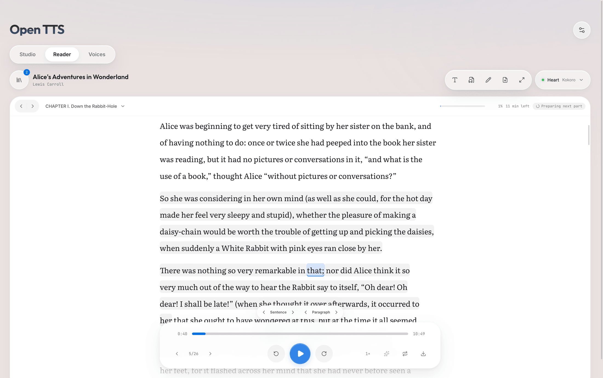

<div align="center">

# Open TTS

**A local text-to-speech studio. No account, no API key, no cloud.**

Ten on-device voice engines, voice cloning, and a long-book Reader with audiobook export.

[](https://github.com/cyanxxy/Local-TTS-studio/releases/latest)
[](https://github.com/cyanxxy/Local-TTS-studio/actions/workflows/ci.yml)
[](./LICENSE)
[](./docs/development.md#requirements)



[Features](#features) · [Models](#models) · [Quick start](#quick-start) · [User guide](./docs/user-guide.md) · [Changelog](./CHANGELOG.md)

</div>

## Features

- **Private by design.** Every engine runs on your machine. The network is only used to download pinned model files on first use.
- **Reader.** Import EPUB, PDF, Office, images, text, or a web article and listen with word-level seeking, gapless section changes, bookmarks, highlights, notes, and a sleep timer.
- **Audiobook export.** One MP3 with chapter markers, or a zip of chapter MP3s with a playlist and cover.
- **Studio.** Generation history, three-take variations, multi-speaker dialogue scripts, and creator presets.
- **Voices** <sup>desktop</sup>. One library for every engine's voices, plus instant voice cloning from a short clip and voice design from a text description.
- **Pro export.** WAV, FLAC, and MP3 with loudness targets (including ACX), a true-peak limiter, and SRT/VTT captions.
- **Text control.** Pronunciation dictionaries, number and date normalization, cleanup of citations and Markdown, and exact `[pause 500ms]` tags.

Full details: [User guide](./docs/user-guide.md).

## Models

| Model | Runs on | Highlights |
|---|---|---|
| **Kokoro-82M** | Web · Desktop | Default engine, 28 voices, WebGPU or WASM |
| **Kitten TTS Nano 0.8** | Web · Desktop | 60 MB, eight English voices |
| **Paradee-8M** | Web · Desktop | 9 MB, starts almost instantly on the CPU |
| **Piper** | Web · Desktop | Eight permissively licensed English voices |
| **Supertonic 2 / 3** | Web / Desktop | 31 languages and expression tags (v3) |
| **Chatterbox Turbo** | Desktop | Zero-shot cloning, `[laugh]` and `[sigh]` tags, WebGPU |
| **Audio8 TTS 0.6B** | Desktop | 44.1 kHz native CPU inference, six voices |
| **Qwen3-TTS 1.7B** | Desktop | Custom voices, cloning, and VoiceDesign (MLX or LibTorch) |
| **NeuTTS Nano / Air** | Desktop | Reference-voice cloning in four languages |

The Electron desktop app is the main product; the web build offers the browser engines only.
Sources, licences, and per-model notes are in the [user guide](./docs/user-guide.md#models).

## Quick start

Requires Node.js 24.19 (pinned in `.nvmrc`), npm 11.17+, and, for the desktop app, [rustup](https://rustup.rs/) on Apple Silicon macOS or Windows x64.

```bash
npm run setup:desktop   # install dependencies and check native prerequisites
npm run dev:desktop     # launch the desktop app

npm run setup:web       # or: browser-only build
npm run dev:web         # http://localhost:5173/studio
```

GitHub Releases are source-only; build a local package with `npm run dist:mac` or `npm run dist:win`.
See [Development](./docs/development.md) for prerequisites, every script, and signed builds.

## Documentation

| Guide | What's in it |
|---|---|
| [User guide](./docs/user-guide.md) | Features, models, settings, shortcuts, document import |
| [Development](./docs/development.md) | Requirements, scripts, install-script policy, packaging, benchmarks |
| [Architecture](./docs/architecture.md) | Source map, engine registry, adding an engine |
| [Local runtimes](./docs/local-runtimes.md) | Rust bridge, Audio8 worker, Qwen3 setup, troubleshooting |
| [Local persistence](./docs/storage.md) | Reader library, Voice Library, History, caches |
| [Release process](./docs/releasing.md) · [Performance](./docs/performance.md) · [Design system](./docs/design-system.md) | Maintainer references |

## Credits

Open TTS is a shell around other people's research. The models and runtimes are theirs:

| Project | Role in Open TTS |
|---|---|
| [Kokoro-82M](https://huggingface.co/hexgrad/Kokoro-82M) by hexgrad | Default model, via the [`onnx-community`](https://huggingface.co/onnx-community/Kokoro-82M-v1.0-ONNX) export and [`kokoro-js`](https://github.com/hexgrad/kokoro) |
| [Supertonic](https://huggingface.co/Supertone) by Supertone | Supertonic 2 (web) and 3 (desktop) |
| [Kitten TTS Nano 0.8](https://huggingface.co/KittenML/kitten-tts-nano-0.8-fp32) by KittenML | Small English model (Apache-2.0) |
| [Paradee-8M](https://huggingface.co/sahilmahendrakar/Paradee-8M-v1.0) by Sahil Mahendrakar | 9 MB voice distilled from Kokoro `af_heart` (Apache-2.0) |
| [Piper](https://github.com/rhasspy/piper) voices by rhasspy | English voices from [`rhasspy/piper-voices`](https://huggingface.co/rhasspy/piper-voices) (MIT); LibriVox and LJ Speech datasets are public domain, and **LibriTTS** by Zen et al. ([OpenSLR 60](https://www.openslr.org/60/)) is [CC BY 4.0](https://creativecommons.org/licenses/by/4.0/) |
| [Chatterbox Turbo](https://huggingface.co/ResembleAI/chatterbox-turbo-ONNX) by Resemble AI | Zero-shot cloning with expression tags (MIT) |
| [Audio8 TTS](https://huggingface.co/Audio8/Audio8-TTS-Preview-0.6B-ONNX-INT4) by Audio8 | Native ONNX INT4 model, runtime adapted from Audio8's Apache-2.0 reference |
| [NeuTTS](https://github.com/neuphonic/neutts-air) by Neuphonic | Nano and Air voices via the `neutts` Rust crate |
| [Qwen3-TTS](https://github.com/QwenLM) by the Qwen team · [`qwen3-tts-rs`](https://github.com/juntao/qwen3_tts_rs) by juntao | Desktop voice model and its Rust implementation, vendored and patched ([notes](./rust/vendor/qwen3-tts-rs/OPEN_TTS_VENDOR.md)) |
| [eSpeak NG](https://github.com/espeak-ng/espeak-ng) | Phonemizer (GPL-3.0-or-later) for Kokoro, Kitten, Paradee, and Piper |
| [ONNX Runtime](https://onnxruntime.ai) · [Transformers.js](https://github.com/huggingface/transformers.js) | Browser and Node model execution |
| [MLX](https://github.com/ml-explore/mlx) · [LibTorch](https://pytorch.org) | Native tensor backends for Qwen3-TTS |
| [LiteParse](https://www.llamaindex.ai/liteparse) by LlamaIndex | PDF, Office, and image extraction |

Model weights download from their upstream hosts at pinned revisions and are not redistributed here. Each model has its own licence; check it before reusing the model elsewhere.

## License

[Apache License 2.0](./LICENSE)
