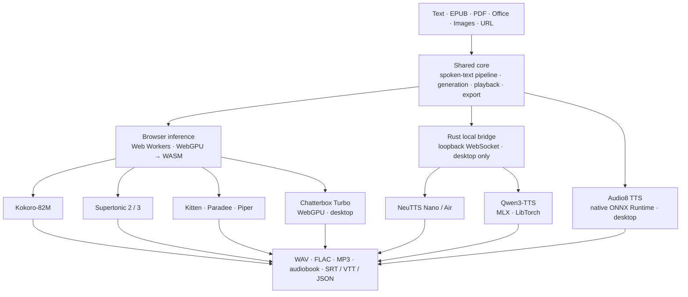

# Architecture

This document keeps maintainer-facing architecture details out of the top-level README.



NeuTTS and Qwen3 run through `open-tts-local-bridge`, a compiled Rust binary that Electron keeps warm behind a per-launch loopback capability token (it protects local IPC and is not user or cloud authentication). Audio8 runs its ONNX graphs in an Electron-owned Node worker thread, and Supertonic 3 uses a renderer worker. Text passes through one spoken-text pipeline (cleanup, pronunciation, normalization, then pause tags) before any engine sees it, so those tools behave the same on every engine.

## Tech Stack

- React 19 + TypeScript 6 in strict mode + Vite 8 + Tailwind CSS 4
- `@huggingface/transformers` v4 for the Supertonic 2 pipeline
- `onnxruntime-web` for the direct-ONNX browser engines (Supertonic 3, Kitten, Paradee, Piper, Chatterbox Turbo)
- `onnxruntime-node` for the Electron-only Audio8 graph sessions, run natively in a `worker_threads` worker
- `kokoro-js` v1 for Kokoro-82M generation with custom phonemization; its eSpeak NG `phonemizer` build is also served as an unbundled asset to Kitten, Paradee, and Piper
- Electron 45 for the desktop app (the product; the web build is deprioritized)
- Rust local bridge for Electron probe/WebSocket transport
- Vitest 5 + Testing Library + jsdom for tests
- `lucide-react` for icons

## Source Map

```text
electron/
|-- main.ts, preload.ts   Composition root and the renderer bridge
|-- ipc/                  Feature IPC modules; channels.ts is the one channel list
|-- localTts/             Rust-bridge runtime: requests, keep-warm leases, warm-ups, Qwen3 setup
|-- wsBridge/             WebSocket client pieces (protocol, stream validator, watchdog, process, connection)
|-- nativeModels/         Framework for native ONNX models (Audio8 is the first consumer)
`-- audio8*, qwen3*, readerLibrary*, document*, ...   Per-feature modules
rust/
|-- Cargo.toml            Workspace: shared dependency versions and release profile
|-- bridge-core/src/      Model-free: protocol.rs, ws/ (transport), request validation, streaming policy
|-- local-tts-bridge/src/ cli.rs, neutts_backend/, qwen3/ (host, engines, runtime, target, ...)
`-- vendor/qwen3-tts-rs   Hand-maintained snapshot (see OPEN_TTS_VENDOR.md)
src/
|-- apps/{web,desktop}/   Renderer shells and entrypoints
|-- models/               Engine registry: one descriptor per engine (registry.ts is the list)
|-- shared/               SynthesisApp shell, session context, EngineRuntime contract, speech-pipeline runtime wrapper
|-- components/           Surfaces (Studio, Reader, Voices, setup pages) and their UI; reader/, creator/, voices/, localRuntime/
|-- hooks/                Orchestrator, runtimes, Reader session, playback, history, takes, dialogue
|-- lib/                  Audio, export, speech pipeline, text, pronunciation, voice library, history, audiobook, caches
|-- workers/              Engine workers on the shared kit (workers/kit), pinned manifests, and the export worker
`-- types.ts              Worker protocol and shared UI types
```

### Engine registry (`src/models`)

`registry.ts` is the single list of engines. Each descriptor (`kokoro.ts`, `kitten.ts`, `piper.ts`, `chatterbox.ts`, `audio8.ts`, ...) is metadata plus pure functions: id, label, runtime kind (`browser-worker`, `renderer-worker`, `native-worker`, `rust-bridge`), targets (`web`, `desktop`), which picker lists it, capabilities (speed, pauses, seed, voice cloning, expression tags, streaming granularity), voices, default settings and a `parseSettings` that validates stored data, preview chunking, credits, and `signatureParts` (the inputs that shape audio, which drive Reader cache signatures). The `EngineId`, `BrowserEngineId`, `DesktopInlineEngineId` and related unions derive from the registry. Descriptors must stay safe for the web bundle: no `electron/` imports, no worker modules, no React, and no `onnxruntime-web` runtimes (use runtime-free modules such as `src/lib/phonemeModels.ts`).

### Adding an engine

1. Add `src/models/<id>.ts` exporting a descriptor, and one line in `ENGINES` in `registry.ts`. The id unions, pickers, labels, routes, persistence (`tts-engine-settings-v1`) and Reader cache signatures follow from it.
2. Implement the runtime. A browser engine adds a worker under `src/workers/` built on `src/workers/kit` (see below) and a pinned manifest in `src/workers/manifests/` (generate it with `node scripts/pin-hf-assets.mjs --repo ... --revision ... --include ... --name ... --out ...`; `--check` verifies it). A native ONNX engine adds an `electron/nativeModels` descriptor and asset table, a worker built on `startNativeModelWorker`, and a client subclass of `NativeModelWorkerClient`. A Rust-bridge engine implements `ws::Backend` in the bridge, keeps its payload validation in a model-free `request.rs` in `rust/bridge-core`.
3. Provide an `EngineRuntime` (`src/shared/engineRuntime.ts`) and register it in the orchestrator (`useEngineOrchestrator`), plus its settings type in `EngineSynthesisSettings`.
4. Add the new id to every exhaustive switch over engines, notably `src/lib/readerListening.ts` (the Reader listening profiles); these switches have no default branch, so TypeScript fails the build until the new id is handled.
5. Add credits (the descriptor's `credits`), the README model and credits tables, and the model table in `docs/user-guide.md`, then run `npm run lint`, `npm run typecheck`, and the tests.

### SynthesisApp shell and session

`src/shared/SynthesisApp.tsx` is a shell. State lives in `useSynthesisSessionState` and is provided through `SynthesisSessionProvider` (`synthesisSessionContext.ts`); the surfaces that read it are `StudioSurface`, `ReaderSurface`, and `LocalRuntimePages` in `src/components/`, beside `AppHeader`, `ErrorBanner`, and `AppFooter`. `useEngineOrchestrator` owns engine selection, the keyed runtime map, and surface-scoped activation; `useAppShortcuts`, `useDocumentImport`, and `useReaderSections` are separate hooks. The lazy Reader, setup pages, and settings dialog each sit in a `SurfaceErrorBoundary`, and `lazyWithRetry` retries a failed chunk import once, so a failed surface shows a retry card and Studio's script and audio survive.

### EngineRuntime and the orchestrator

Every engine implements the `EngineRuntime` contract in `src/shared/engineRuntime.ts`. Its `synthesize(request)` renders a self-contained request (text, per-engine settings, tuning, optional seed and `AbortSignal`) to an `AsyncIterable` of chunks. Requests run one at a time per engine in FIFO order, wait for and block that engine's surface generation, are abortable, report errors per request, and never touch the shared player. Look-ahead, audiobook export, previews, variations, and dialogue all use it. Qwen3's queue also waits out the bridge's 500 ms admission window (600 ms) after the last completed request.

`useEngineOrchestrator` holds all runtimes in one keyed map and wraps each runtime's `synthesize()` in the spoken-text pipeline (below). It keeps the user's chosen model and derives the active model from what can run, so a device without WebGPU keeps a saved Chatterbox choice but runs the default engine, and requests no worker for the unavailable one. `useModelLoader` is a worker pool keyed by registry browser ids: only the selected engine's worker starts, unused workers are evicted after 15 s (`BROWSER_MODEL_IDLE_EVICT_MS`), and `acquireWorker` loads an engine on demand for background requests.

### Reader session

`useReaderSession` composes `useReaderAudioCache` and `useReaderProgress` over `useReaderLibrary` and `useReaderSections`. `useReaderLookahead` renders the next section in the background through the shared synthesize queue (it is preempted when the user generates, a request waits for its `settled()` promise, and a pending request is dropped on a section or book change) under a memory budget. `useReaderListeningProfile` applies a book's saved engine, voice, language, quality, and speed, and sets aside Studio's values so they return when Studio is shown; a profile pending on a different engine stops the cache from clearing audio. `useStudioAudioKeeper` snapshots Studio's unsaved audio when the Reader takes the shared player and restores it paused on return. `useReaderMediaSession` publishes Now Playing metadata and media-key handlers through a silent audio element. `AdvancedReaderPage` is a composition root over `src/components/reader/`; only `ReaderTextPane` subscribes to the playback clock at word rate, and the sleep timer signals holds through `onAutoAdvanceHoldChange`.

### Studio history, takes and dialogue

`src/lib/studioSynthesis.ts` adapts a Studio generation to the shared synthesize path. `useStudioHistory` saves completed generations (keyed on the player's `isSynthesisComplete` transition, using the text, engine, and voice snapshotted when generation starts), `useStudioTakes` renders seeded or speed-varied takes, and `useDialogueSession` parses `Name: line` scripts (`src/lib/dialogue/`), casts engines per speaker, renders turn by turn, and stitches the result with speaker-labelled VTT/SRT.

### Voice Library

`src/lib/voiceLibrary/` holds the store (presets, clones, designed voices, favorites, tags, preview cache), the catalog that merges every engine's voices with the user's, `presetRequest.ts` (builds the real synthesize request for a voice, so the preview key covers every render-affecting input), `portable.ts` (`.voice.zip` import and export with central-directory inspection before reading), and the clone wizard flow. Reference clips are analyzed, trimmed, and resampled by `src/lib/referenceAudio.ts`; microphone capture uses an AudioWorklet (`micCapture.worklet.ts`) with a MediaRecorder fallback. Chatterbox clones are registered through a clip resolver that attaches for the session. The Voices page exists only on desktop.

### Spoken-text pipeline

Text passes through `src/lib/speechPipeline.ts` before any engine chunks it: cleanup (`src/lib/text/cleanup.ts`), then the pronunciation dictionary and optional English normalization (`src/lib/pronunciation/`, `src/lib/text/normalize/`, `speechText.ts`), then break tags (`speechMarkup.ts`, `speechBreakMarks.ts`). `buildSpeechPlan` returns the spoken text plus a source-offset mapping; `createChunkRemapper` maps the engine's chunks, word timings, and segments back to the text the user wrote, so Reader highlighting and captions stay aligned. `speechPipelineRuntime.ts` wraps a runtime's `synthesize()` and clears engine-side rules so they are not applied twice. Pauses use one of two boundary strategies: a blank line (`paragraph`), which relies on every engine chunker keeping a blank line as a passage boundary (a test runs all chunkers over tiny passages to guard it), or a private-use pause mark (`mark`), used for engines with `unit` streaming granularity (Qwen3), whose request plans split on the mark. A break replaces the slider pause at that boundary, is never spoken, and is capped at 10 seconds.

Studio is the landing surface and ships in the entry chunk. The Reader page, the
per-model local-runtime pages, the app settings dialog, and document import
(Readability + zip) are loaded on demand via `React.lazy` / dynamic `import()`,
so opening the app does not parse code for surfaces the session never reaches.
Tests that assert into one of those subtrees must await its mount
(`findBy*`/`waitFor`) rather than querying synchronously after `render`.

The Audio8 runtime is spread across `electron/` by ownership rather than by
feature: `audio8Model.ts` holds the pinned revisions, asset table, and voice
catalogue that every other module reads; `audio8NativeWorker.ts` is the worker
thread that downloads, loads, and runs the graphs; `audio8AssetCache.ts` does
the download and integrity verification; `audio8SharedTask.ts` provides the
reference-counted single-flight both use; `audio8NativeClient.ts` is the
main-process client that owns the worker; `audio8Cache.ts` reports, clears, and
prunes the on-disk cache; and `audio8Threading.ts` picks the intra-op thread
count. The renderer half is `src/hooks/useAudio8Runtime.ts` and
`src/components/Audio8InlineSettings.tsx`, with display metadata in
`src/constants.ts`.

## Worker Protocol

The browser inference path is a strict message contract between the main thread and Web Workers. The canonical TypeScript definitions live in `src/types.ts`.

```text
Main -> Worker:  LOAD, GENERATE, ABORT, CANCEL
Worker -> Main:  LOAD_PROGRESS, READY, AUDIO_CHUNK, GENERATION_COMPLETE, ABORTED, CANCELLED, ERROR
```

The browser workers (Kokoro, Supertonic 2 and 3, Kitten, Paradee, Piper, Chatterbox Turbo) share `src/workers/kit` (messaging, run lock, progress, backend fallback, chunk emission, prefetch, and `phonemeWorker.ts` for the phoneme-model engines). The rules in `src/types.ts`:

- `LOAD`s are serialized, and no progress follows `READY` or `ERROR`.
- Every `AUDIO_CHUNK`, `GENERATION_COMPLETE`, and generate `ERROR` echoes the request's `generationId`.
- `ABORT` is the soft stop: the worker stops the generation in place without closing or reloading the model, posts nothing more for it, and answers with exactly one `ABORTED` carrying the same `generationId`. A stale `ABORT` can never stop a newer generation. A following `GENERATE` may queue behind the aborted inference.
- `CANCEL` is the hard stop: it invalidates every generation, posts `CANCELLED`, and closes the worker, so the next use reloads the model. Hosts use it only for forced cancels and as the fallback when a worker does not answer an `ABORT` within `WORKER_ABORT_TIMEOUT_MS` (5 s, `src/hooks/workerGeneration.ts`); the soft-abort timeout replaces a worker only if the aborted generation is still the newest one posted.
- Generation-time downloads (a Piper voice switch) post `LOAD_PROGRESS` and end at 100; a superseded or aborted download is cancelled through the `GenerationTicket` signal.

Only the selected engine's worker starts at launch; others load on demand.

Single-graph phoneme engines (Kitten, Paradee, Piper) share one pipeline: the unbundled `phonemizer` eSpeak NG asset, `src/lib/espeakPhonemizer.ts`, the model runtime (`kittenRuntime.ts`, `paradeeRuntime.ts`, `piperRuntime.ts`), and the worker kit's phoneme host. Their files are verified against pinned manifests before use and before caching, in the `transformers-cache-kitten-v1`, `-paradee-v1`, and `-piper-v1` Cache Storage entries.

Audio8 uses a separate contract, because its worker is a Node `worker_threads`
worker owned by Electron's main process rather than a Web Worker owned by the
renderer. The canonical definitions live in `electron/audio8NativeClient.ts`
(on top of `electron/nativeModels/workerProtocol.ts`).

```text
Renderer -> Main (IPC):  audio8:load, audio8:generate, audio8:cancel,
                         audio8:cache-info, audio8:clear-cache
Main -> Renderer:        audio8:progress
Main -> Worker:          load, generate, cancel
Worker -> Main:          progress, result, error
```

Every message on the worker side carries a `requestId`, and progress is
delivered to the request that produced it rather than fanned out, so a second
window's download percentages cannot appear in an unrelated progress bar. One
worker serves the whole app: it is spawned on the first request and reused by
every window. Generated audio comes back as one transferred `ArrayBuffer` of
Float32 PCM per request — there is no chunk stream on this path, so the
renderer chunks the text instead and schedules each returned buffer through the
same player. A worker that exits, errors, or goes
`AUDIO8_REQUEST_INACTIVITY_TIMEOUT_MS` (five minutes) without sending anything
rejects everything waiting on it; the next request starts a fresh worker.

## Desktop Document Import

Desktop import crosses three bounded ownership layers. The renderer asks through
the preload bridge; Electron's main process owns the native file dialog, validates
the request, reads direct-text formats, and returns the result over IPC. Formats
that require LiteParse (PDF, Office/OpenDocument, and images) are delegated by
`DocumentParseWorkerClient` to the one-shot `documentParseWorker` worker thread.
That worker dynamically loads LiteParse, performs conversion/OCR, and returns only
bounded text plus a page count. The client terminates it after success, failure,
shutdown, or the five-minute deadline, keeping parser CPU work and native parser
state out of the long-lived main process. EPUB bytes are transferred to the
renderer, where archive and document structure are parsed under separate limits.

## Browser Audio Path

This contract applies to Studio, Reader, and Electron local-runtime playback. Browser models stream chunks from Web Workers; Supertonic 3 uses a separate worker imported only by the Electron renderer. Electron local-runtime pages (NeuTTS and Qwen3) generate through the resident Rust WebSocket bridge worker (`electron/webSocketBridgeWorker.ts` driving `open-tts-local-bridge --action serve-ws`), which streams binary Float32 audio chunks that the renderer schedules through the same Web Audio player. Qwen3 runs in-process through the pinned `qwen3-tts-rs` `TTSInference` APIs: the target package supplies MLX on Apple Silicon or LibTorch on Windows x64, and the bridge dynamically resolves Metal/CUDA availability with a provider-local CPU fallback. Long Qwen jobs carry ordered continuation metadata through main-process admission, reuse Base reference features by worker-session key, and roll back audio from a failed section before exposing partial results. CustomVoice, Base voice cloning, and VoiceDesign share this runtime contract; there is no Candle or upstream Qwen worker fallback. Audio8 uses neither transport: the renderer asks the main process over IPC, the main process runs the graphs in a Node worker thread, and each request returns one Float32 buffer that the renderer schedules through the same player. See [Desktop local runtimes](./local-runtimes.md) for the bridge protocol and the Audio8 worker.

- Playback uses the Web Audio API: `AudioContext` + `AudioBufferSourceNode`.
- Audio chunks are `Float32Array`.
- Streaming chunk handling keeps playback/export refs immediate, while `useTTS` stats/progress and `useAudioPlayer` segment/timeline UI state are coalesced to the next UI frame to avoid per-chunk React render pressure.
- The playback position is **not** React state. It advances every animation frame, so `useAudioPlayer` publishes it through a `PlaybackClock` external store (`src/lib/playbackClock.ts`); components subscribe with `usePlaybackTime` at a leaf that needs frame-rate updates, or with `usePlaybackSelector` to re-render only when a derived value (an active word index, a whole-second readout) changes. Effects and callbacks read it imperatively via `getCurrentTime()`. Adding `currentTime` back to a render path re-renders the whole app 60 times a second.
- The player materialises `AudioBuffer`s and source nodes only `AUDIO_PLAYER_SCHEDULE_HORIZON_SECONDS` ahead of the playhead and releases decoded buffers `AUDIO_PLAYER_RETAIN_BEHIND_SECONDS` behind it, rebuilding them from the retained Float32 PCM on a seek. Because the horizon is short, the schedule is topped up both from the animation-frame loop and from a one-second timer, so playback does not run dry in a hidden browser tab where frames stop. The Electron window additionally sets `backgroundThrottling: false`.
- Export runs in `export.worker.ts` as a streaming pipeline: post-process (trim, pad, fade, smooth joins) -> polyphase resample -> gain -> true-peak limiter (4x plus an 8x safety stage) -> encoder, in `src/lib/audio/`. Formats are `wav-f32`, `wav-pcm24`, `wav-pcm16`, `flac` (16/24-bit), and `mp3`; loudness presets (streaming, podcast, broadcast, ACX) take up to four mastering passes. The worker protocol streams one chunk per message with progress and cancel, and allows a single export in flight; the worker still buffers all input PCM and the encoded output (the WAV header, FLAC `STREAMINFO`, and ID3 tag depend on the finished result).
- Sample rate comes from model output unless the user selects an export resample target. MP3 floors at 64 kbps and caps at 160 kbps below 32 kHz.
- Captions are retimed with the same chunk post-processor an export uses, so trim, padding, and fades move the cues, and are laid out as readable cues (two 42-character lines, 7 s at most, 0.8 s minimum hold).

## Long-Book Reader

Reader keeps the complete normalized document and its real chapter table of contents as the canonical model. `buildReaderSections()` derives deterministic paragraph/sentence-aligned working windows inside those chapters (8,000-character target, 12,000-character maximum). Only the active window is rendered and sent to synthesis, so a very large book never becomes one giant DOM tree, model request, or audio timeline. The active window renders as real paragraph blocks (one `<p>` per source line, with blank-line separation preserved through margins); each block carries its character offset so DOM selections, jumps, and highlight scrolling map exactly back to text offsets. Plain clicks never move playback — seeking is an explicit double-click — and auto-follow pauses as soon as the user scrolls during playback, until they resume it. Arrow keys page between sections, and the library sidebar adds full-text search across the whole book.

- Progress, bookmarks, notes, and chapter navigation use absolute whole-book text offsets. Audio segment offsets and playback time remain local to the active section; `SynthesisApp` translates between the two boundaries.
- Section IDs are derived from stable chapter IDs and their in-chapter order. They are not a second table of contents.
- Generated PCM is cached independently by `[documentId, sectionId]`. A signature of section text plus model, voice, quality, and tuning invalidates only incompatible audio. Persistent storage uses small metadata records for LRU pruning and is bounded to 96 sections or 512 MiB; the faster session-memory LRU is separately bounded to 12 sections or 192 MiB.
- The web build uses IndexedDB version 3 for document, settings, and section-audio stores. Electron uses the public-domain SQLite engine bundled with its Node.js runtime, owns the connection in a dedicated worker, and streams PCM to that worker in bounded chunks. It stores the same Reader contract under the local app-data directory. See [Local persistence](./storage.md).
- IndexedDB upgrades delete the obsolete document-level `audio` store rather than migrating it. Records loaded from older profiles are normalized in memory to add section IDs while preserving book text and annotations.
- The first desktop read imports documents a pre-SQLite release left in the renderer's IndexedDB, ahead of the "empty library, seed a starter document" path, so an upgrade never presents an empty library. Cached audio is not carried over; the IndexedDB copy is left intact.
- Quitting the desktop app asks each renderer to flush its debounced Reader writes and waits for them before closing the worker; window and tab teardown flush the same way on both targets.
- At a section boundary, Reader flushes the completed cache before restoring a compatible next section or generating it. Automatic continuation is a persisted Reader preference, enabled by default, and can be disabled.
- Signatures are version 2 and hash only the inputs the selected engine reads (`signatureParts`, plus a fingerprint of the spoken-text pipeline when it changes the text). Version 1 entries whose inputs match are recognized and re-saved under version 2; others regenerate once.
- Progress is a separate small record (throttled to every 5 s while playing; written on pause, hide, and quit), so playing never rewrites the book. The metadata store keeps each section's signature and `synthesisComplete`, so the cache can answer "is this section complete" without reading its audio.
- Exact-word seeking (double-click, contents, search) uses the shared word-timing estimator in `src/lib/text/wordTiming.ts`, which Reader highlighting and captions also use.
- Audiobook export (`src/lib/audiobook/`) plans chapters, renders any section that is not cached through the shared synthesize queue into the export's own bounded resume store (256 MiB, oldest chapters dropped; cleared after success), encodes each chapter to MP3, and writes either one MP3 with `CHAP`/`CTOC` markers or a zip of numbered chapters with a playlist and cover. Chapter durations come from counting MP3 Layer III frames. Chapters are encoded separately, so a boundary can carry a few milliseconds of encoder padding.

## Model-Specific Notes

- **Kokoro** builds inference units through `buildKokoroInferenceUnits()` in `src/lib/chunking.ts`, merging sentence ranges up to the selected backend budget and splitting oversized single ranges before generation. It calls `tts.generate(string, ...)` per unit; `tts.stream()` is not used. `list_voices()` may return `void` in some `kokoro-js` versions, so fallback voices are required. Because `kokoro-js` 1.2.1 does not forward a model `revision`, the worker pins Transformers.js's remote path template to the immutable Kokoro revision and separately rewrites model/voice fetch URL variants to that revision. WebGPU loads run a small warmup generation before READY, forced reload disposes the previous model when supported, and WASM fallback sets a safe multi-thread count when cross-origin isolation allows SharedArrayBuffer.
- **Supertonic 2 and 3** build semantic units for headings, lists, quotes, code, sentences, and paragraph boundaries, then adapt target and maximum chunk sizes to the active backend and quality. Failed chunks are subdivided and retried with bounded depth. Inter-chunk pauses are shaped by boundary kind (`none`, comma, sentence, or paragraph) and user overrides; they are not a fixed 0.5-second pad. Per-file download progress is aggregated dynamically. Supertonic 2 is web/iOS-only; Electron does not list or initialize its worker. Supertonic 3's revision-pinned direct ONNX runtime, 31-language table, and preset style loader exist only in the desktop dependency graph. The app-level `onnxruntime-web` version is an exact lockstep dependency of Transformers.js because both consumers use its emitted WASM assets; upgrading it independently can create an ABI mismatch, so `vite.onnxRuntimeVersion.test.ts` guards that relationship until Transformers.js moves to a stable runtime release.
- **Audio8** is desktop-only and native: `electron/audio8NativeWorker.ts` runs three `onnxruntime-node` CPU sessions in a worker thread — a slow autoregressive transformer that emits one semantic token and a hidden state per frame, a fast transformer that expands that hidden state into the remaining acoustic codebooks, and a codec decoder that turns the finished code matrix into 44.1 kHz Float32 PCM. Everything shape-dependent (sequence lengths, layer and head counts, codebook size, token ids) is read from the model's own `runtime_manifest.json` rather than hard-coded, and everything repository-dependent (pinned model and voice-Space revisions, asset table, voice ids, text limit) lives in `electron/audio8Model.ts`. The renderer keeps only display metadata for the same voices in `src/constants.ts`, because importing the desktop module would pull the download machinery into the web bundle; `vite.audio8Catalogue.test.ts` asserts the two lists and the quoted download size stay in agreement. The sampler is seeded (mulberry32, seed 42), so one text, voice, and revision reproduce the same audio, which is what makes a regression in the inference loop detectable. The renderer chunks text to 180 characters because the voice-reference prompt is re-prefilled before every chunk's first token, while the IPC boundary independently rejects anything over `AUDIO8_MAX_TEXT_CHARACTERS` (1,000) so a malformed payload cannot pin a core. Intra-op threads use up to four Apple performance cores on arm64 macOS and `min(6, availableParallelism())` elsewhere; using efficiency cores hurts latency, while the cap avoids the memory-bandwidth regression measured above four threads on M1 Pro. The app-level `onnxruntime-node` version is pinned exactly and re-pinned through `overrides`: Transformers.js and `kokoro-js` depend on it too, Transformers.js imports it from a static top-level import, and the Audio8 worker loads both — so a second resolved copy would load a second native ONNX Runtime into that one thread. `vite.onnxRuntimeVersion.test.ts` therefore checks the installed version and that the whole lockfile resolves exactly one.

- **Kitten, Paradee, and Piper** are single-graph phoneme models on `onnxruntime-web`. Kitten reads exact per-word timings from the model's duration output and can use WebGPU (falling back to WASM on the same bytes; warm-up rejects non-finite audio). Paradee and Piper are CPU/WASM by design, so the footer does not show a Wasm/CPU badge for them. Piper's catalog (`src/workers/manifests/piperVoices.ts`, generated by `scripts/pin-piper-voices.mjs`) follows each voice's training lineage and excludes any voice with a non-permissive or unresolvable ancestor.
- **Chatterbox Turbo** needs WebGPU: its quantized graphs use `GatherBlockQuantized`, which the WASM provider lacks. References are prepared to a trimmed, normalized 24 kHz window (at most 10 s) and only that clip is copied per worker.

## Browser Support Notes

- Desktop web browsers expose Kokoro, Supertonic 2, Kitten, Paradee, and Piper; the Electron shell exposes Supertonic 3 instead of Supertonic 2 and adds Chatterbox Turbo (WebGPU only).
- iPhone and iPad browsers expose Supertonic only; Kokoro is disabled there pending validation.
- WebGPU is preferred where available; WASM fallback is supported where the selected model is enabled.
- Electron enables Chromium's `enable-unsafe-webgpu` switch because WebGPU is otherwise unavailable in the packaged desktop shell.
- Cross-origin isolation matters. The Vite dev server and the Electron shell send COOP/COEP headers; without them, WASM fallback degrades to single-threaded execution.
